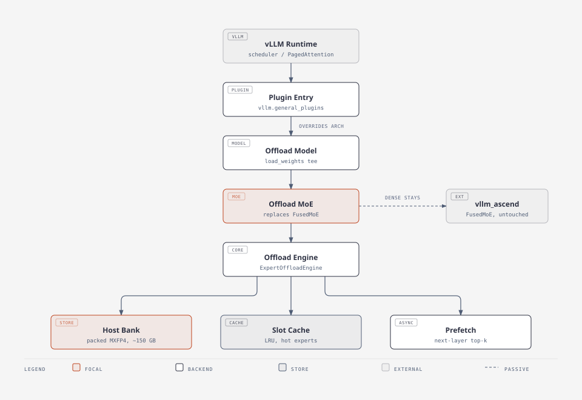
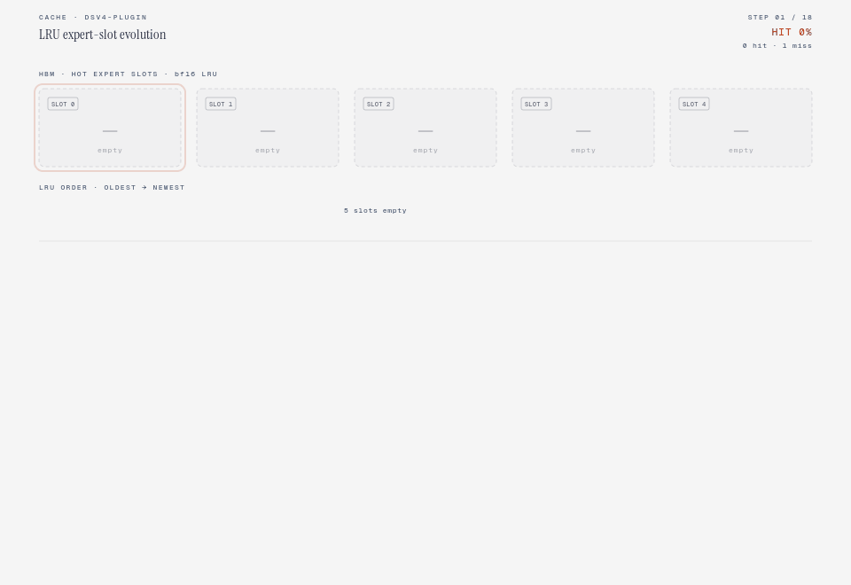
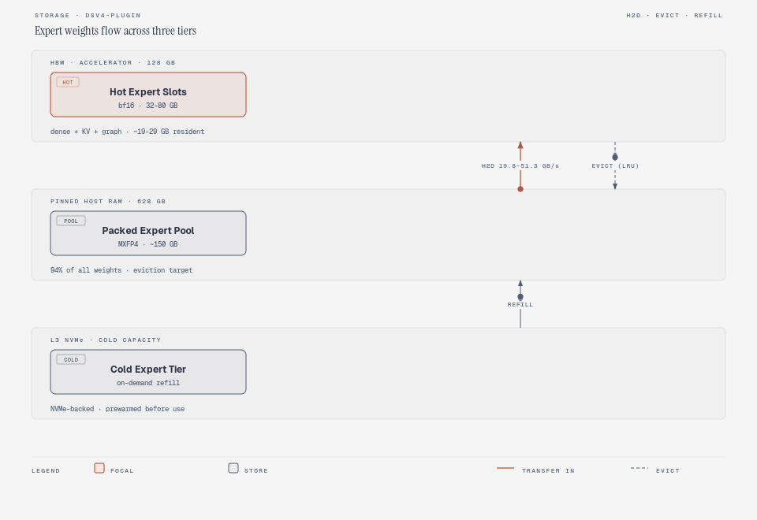
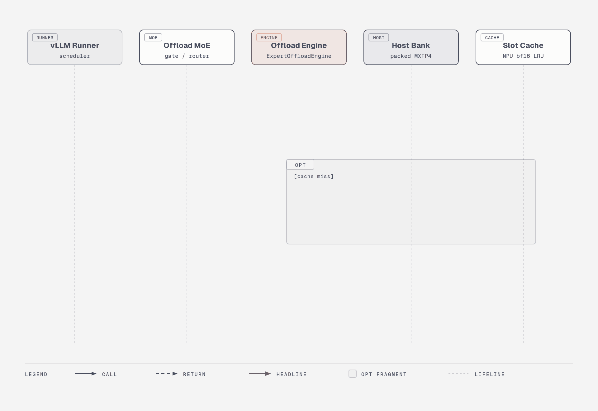
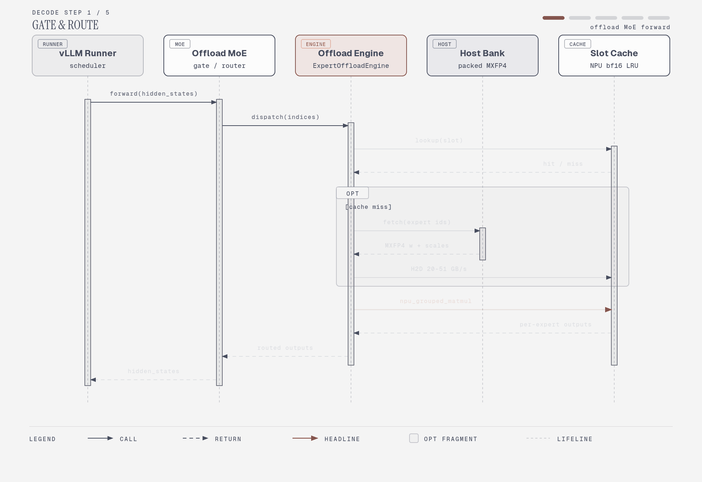
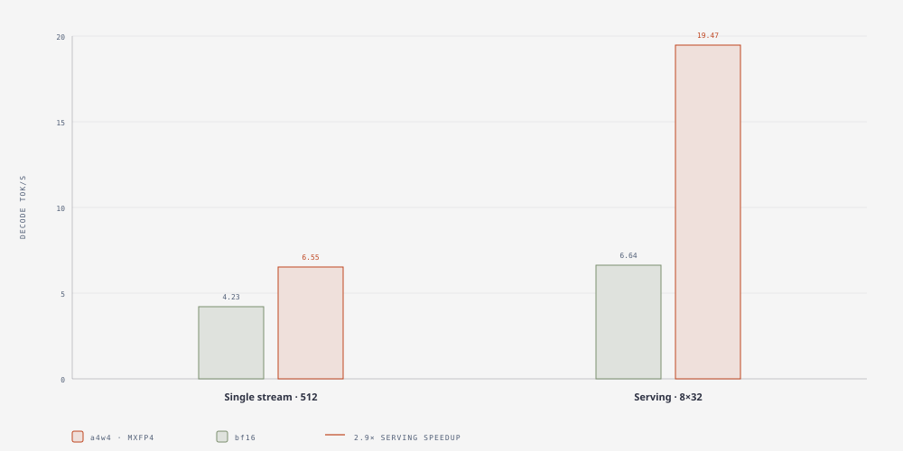

# dsv4-plugin

**在单张昇腾 NPU 上，以 out-of-tree 插件方式为 vLLM / vllm-ascend 实现 `DeepSeek-V4-Flash` 专家卸载推理。**

[English](README.md) | [中文](README_zh.md)

---

## 概述

`dsv4-plugin` 让 **单卡 Ascend 950PR（128 GB HBM）** 能够服务 `DeepSeek-V4-Flash`，且**不 fork** vLLM / vllm-ascend。

权重约 159.6 GB，其中路由专家约 150.6 GB（94%），远超单卡 HBM。因此插件不把专家全部解压上卡，而是将专家以**打包态（MXFP4）常驻 host 内存**，按需搬运到 NPU，并用 **LRU 槽位缓存**保存已上卡的专家。

它完全通过 vLLM 标准插件入口安装：运行时替换一个 MoE 类，并包裹 `load_weights`。**不改 `site-packages`、不 fork。**

## 为什么需要它

| 约束 | 数值 |
|---|---|
| 权重总量 | ~159.6 GB |
| 路由专家 | ~150.6 GB（94.4%） |
| dense（非专家） | ~9 GB |
| 硬件 HBM | 128 GB |

专家无法全部驻留显存，**必须**放到卡外，同时保留引擎能力（PagedAttention、连续批处理、OpenAI 服务化）。

## 架构



三级存储：

| 层 | 内容 | 预算 |
|---|---|---|
| HBM（128 GB） | dense 权重 ~9 GB + KV/激活/图 10–20 GB + 热专家槽位 32–80 GB | ≤ 128 GB |
| host pinned RAM（628 GB） | 打包 MXFP4 专家池 ~150 GB | 充裕 |
| L3 NVMe | 冷专家兜底（可选） | — |

### 热专家槽位

热专家缓存在 HBM 槽位中，按 LRU 淘汰；随着工作集稳定，命中率逐步升高。



### 数据流



### 单步执行时序



同一单步的引导式动画，逐阶段演示：



## 特性

- **不 fork**：通过 `vllm.general_plugins` 注册，import 时仅替换一个 MoE 类与 `load_weights`。
- **专家打包常驻 host**：FP4 专家以 int8 nibble + E8M0 per-32 scale 保存，一次 miss 只搬 bf16 的 1/4 流量，再在卡上解量化。
- **两套精度 profile**：`bf16`（无损参考路径）与 `a4w4`（MXFP4 常驻，更快）。
- **昇腾 grouped-GEMM**：一层内所有被激活专家用**单次** `torch_npu.npu_grouped_matmul` 算完，替代逐专家 Python 循环。
- **host 锁页内存**：打包专家 H2D 从 ~19.8 提升到 ~51.3 GB/s。

## 实测结果

均在单卡 Ascend 950PR（128 GB HBM）、`DeepSeek-V4-Flash`、贪心解码下测得。完整记录见 [DESIGN.md](DESIGN.md) §9 / §10。



单流（64-token 贪心；专家在 FP4 下体积约为 1/4）：

| 配置 | tok/s | 专家命中率 | 专家显存≈ |
|---|---|---|---|
| `a4w4` @512 打包槽 | 6.55 | 0.42 | 6.9 GB |
| **`a4w4` @2048 打包槽** | **7.10** | **0.81** | 27.4 GB |
| `bf16` @512 槽（基线） | 4.23 | 0.79 | 25.8 GB |

等显存对比：**`a4w4`@2048 vs `bf16`@512 = 1.68×**。

服务化（8 并发 × 32 token = 256 tokens，`python accept.py`）：

| profile | 命令 | 聚合 tok/s |
|---|---|---|
| `bf16` | `./serve.sh` | 6.64 |
| `a4w4` | `PROFILE=a4w4 ./serve.sh` | **19.47**（约 2.9×） |

内核层面：grouped-GEMM 路径比逐专家循环快 **4.8–5.7×**，且在 bf16 路径上**逐位一致**（`max_abs_diff = 0.0`）。

> `a4w4` profile 会把激活量化为 MXFP4，其数值偏差大于 fp8 参考路径，**不是逐位对齐**；`bf16` 才是无损基线。容差讨论见 [DESIGN.md](DESIGN.md) §9。

## 环境要求

| 组件 | 版本 / 说明 |
|---|---|
| 硬件 | 单卡 Ascend 950PR，128 GB HBM |
| Python | 3.12 |
| vLLM | 0.23.0 |
| vllm-ascend | 0.23.0（950 定制 cp312 wheel） |
| torch / torch-npu | 随 vllm-ascend wheel 要求 |
| CANN | 与 vllm-ascend 0.23.0 构建匹配 |

运行时依赖（`torch` / `torch-npu` / `vllm` / `vllm-ascend`）**刻意不在** `pyproject.toml` 中声明，避免安装本包时去动这些重依赖，请按厂商指引单独安装。

此外需要磁盘上有 `DeepSeek-V4-Flash` 权重（例如 `/home/models/DeepSeek-V4-Flash`）。

## 安装

```bash
# 1. 准备昇腾 + vLLM + vllm-ascend 环境（CANN、torch-npu 等）

# 2. 安装本插件（entry point 会自动向 vLLM 注册）
pip install -e .
```

确认插件被加载：

```bash
python -c "import vllm_ascend.models.deepseek_v4 as v4; import dsv4_plugin; \
dsv4_plugin.register_model(); print(v4.DeepseekV4MoE.__name__)"
# -> OffloadDeepseekV4MoE
```

## 用法

### 起服务

```bash
# 必填：把 PYTHON 指向装有 vllm 的解释器（通常是你的 venv）
export PYTHON=/path/to/venv/bin/python

# 无损 bf16 profile（默认）
./serve.sh

# MXFP4 常驻 profile（更快；激活被量化，见「实测结果」）
PROFILE=a4w4 ./serve.sh
```

`serve.sh` 会拉起一个 OpenAI 兼容服务，验收：

```bash
python accept.py            # BASE_URL / MODEL / N / MAX_TOKENS 可覆盖
```

### 环境变量

| 变量 | 默认值 | 含义 |
|---|---|---|
| `PYTHON` | `python3` | 装有 `vllm` 的解释器（通常是 venv） |
| `DSV4_MODEL` | `/home/models/DeepSeek-V4-Flash` | 权重路径 |
| `PROFILE` | `bf16` | `bf16` 或 `a4w4` |
| `DSV4_EXPERT_SLOTS` | `512` | NPU bf16 专家槽位 |
| `DSV4_PACKED_SLOTS` | `4 × DSV4_EXPERT_SLOTS` | NPU 打包 FP4 专家槽位 |
| `DSV4_PIN_HOST` | `1` | 将打包专家放入 host 锁页内存 |
| `DSV4_MXFP4_GMM` | `0` | `1` = 启用 a4w4 grouped-GEMM 路径 |
| `HOST` / `PORT` | `0.0.0.0` / `8000` | 服务监听地址 |
| `MEM_UTIL` | `0.75` | `gpu-memory-utilization` |
| `MAX_MODEL_LEN` / `MAX_NUM_SEQS` | `2048` / `8` | 服务上限 |
| `ASCEND_TOOLKIT_ROOT` | `/usr/local/Ascend/ascend-toolkit` | CANN toolkit 根目录 |
| `ASCEND_ATB_ROOT` | `/usr/local/Ascend/nnal/atb` | ATB 根目录 |
| `DSV4_EXTRA_LIBDIR` | *(未设置)* | 可选的额外 `LD_LIBRARY_PATH` 目录 |

## 测试

测试均为脚本，在昇腾环境下于仓库根目录直接运行。需要真实权重的用例读取 `DSV4_MODEL`。

```bash
python test_npu_ops.py        # 算子正确性（对比 torch 参考）
python test_offload.py        # ExpertBank host 池 + NPU 槽位缓存
python test_loader.py         # 权重加载（合成 + 真实权重）
python test_model.py          # model_npu 前向（微型 + 真实配置）
python test_moe_align.py      # MoE 数值对齐（bf16 逐位一致 / a4w4 容差）
python test_plugin_load.py    # load_weights tee + 专家捕获
python test_e2e_vllm.py       # 真实 vLLM 引擎端到端
```

## 目录结构

```
offload.py                  ExpertBank：host 打包专家 + NPU LRU 槽位缓存
npu_ops.py                  昇腾算子重实现（FP4/FP8 反量化等）
loader.py                   流式权重加载器（参考实现）
model_npu.py                独立参考模型（逐 token 对齐基线）
dsv4_plugin/
  __init__.py               register_model() —— vLLM 插件入口
  core/engine.py            ExpertOffloadEngine（包裹 ExpertBank）
  models/deepseek_v4.py     MoE 接管 + load_weights tee
serve.sh                    启动 OpenAI 兼容服务
accept.py                   HTTP 验收基准
test_*.py                   测试 / 自检脚本
pyproject.toml              打包 + vllm.general_plugins entry point
DESIGN.md                   设计文档 + M4/M5 实测记录（中文）
```

## 设计文档

- [DESIGN.md](DESIGN.md) —— 完整设计依据、接管点、里程碑记录与实测结果（中文）。

## 限制与说明

- **MTP / 投机解码不在范围内**：`mtp.*.ffn.experts.*` draft 层专家未由本插件接管。
- **仅单卡**：此处专家卸载假设 TP=1、无专家并行。
- **`a4w4` 与 fp8 参考路径不逐位一致**（激活量化不同），按调优后的容差验证。
- 数据来自特定 CANN / vllm-ascend 构建，不同构建可能有所差异。

## 许可证

[Apache-2.0](LICENSE)。
